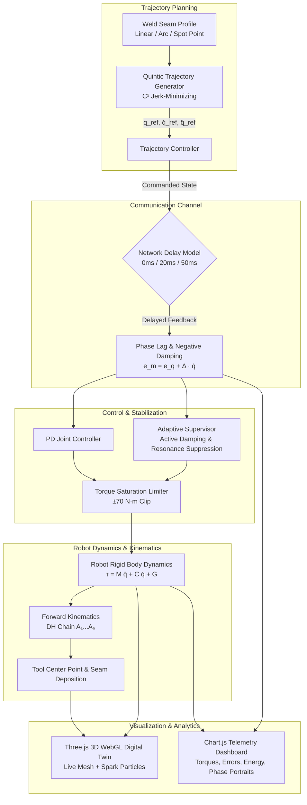

# 🦾 ABB IRB-120 6-DOF Robotic Welding Control & Digital Twin

[](https://mithunyechuru.github.io/Industrial-Manipulator-Modeling-Adaptive-Control/)
[](https://www.python.org/)
[](https://threejs.org/)
[](https://www.chartjs.org/)
[](https://opensource.org/licenses/MIT)
[](https://new.abb.com/products/robotics/industrial-robots/irb-120)

> 🚀 **Public WebGL Live Demo**: Experience the 3D digital twin directly in your browser without any installation:  
> 👉 **[https://mithunyechuru.github.io/Industrial-Manipulator-Modeling-Adaptive-Control/](https://mithunyechuru.github.io/Industrial-Manipulator-Modeling-Adaptive-Control/)**

A high-fidelity **Robotic Welding Control System & 3D WebGL Digital Twin** for the **ABB IRB-120 6-DOF industrial manipulator**. This project models kinematics, rigid-body dynamics, quintic trajectory planning, communication latency instability, torque saturation limits, and adaptive supervisory damping for automated weld seams.

---

## 🌟 Key Highlights

- **Interactive 3D WebGL Digital Twin (`robotics.html`)**:
  - Full 6-DOF robotic arm visualization in **Three.js** with realistic mesh kinematics, joint hierarchies, coordinate frames, and customizable camera views (Orbit / ISO / Top / Side / Front / TCP Follow).
  - Dynamic weld spark particle system, molten weld seam deposition, and heat-affected zone (HAZ) shading.
  - Interactive manual joint jog + automated trajectory execution.
- **Kinematics & Dynamics Mathematical Engine (`ai_robotics_2026.py`)**:
  - **Forward Kinematics (FK)** via Denavit-Hartenberg (DH) parameter transformation matrices.
  - **Inverse Kinematics (IK)** using numerical Jacobian pseudo-inverse ($J^\dagger$) convergence.
  - **Inverse Dynamics (ID)** computing torques $\tau = M(q)\ddot{q} + C(q,\dot{q})\dot{q} + G(q)$ with full gravity compensation.
  - **Forward Dynamics (FD)** solving instantaneous joint accelerations $\ddot{q} = M(q)^{-1}(\tau - G(q))$.
  - **Quintic Trajectory Generation ($C^2$ continuous)** minimizing jerk during seam transitions.
- **Communication Delay & Instability Injection**:
  - Simulates teleoperation/remote network delays: **0 ms** (ideal baseline), **20 ms** (minor phase lag), and **50 ms** (severe oscillation / limit cycle hunting).
  - Models delay-induced negative damping: $e_m(t) \approx e_q(t) + \Delta \cdot \dot{q}(t)$.
  - Actuator torque saturation clipping ($\pm 70\,\text{N}\cdot\text{m}$).
- **Adaptive Supervisory Controller**:
  - Injects dynamic counter-torques and virtual damping to stabilize the manipulator under high latency and prevent weld-defect chattering.
- **High-Resolution Empirical Dataset (`abb_irb120_6dof_welding_dataset.csv`)**:
  - 5 ms control loop log containing 20 state variables (joint angles $q_1 \dots q_6$, torques $\tau_1 \dots \tau_6$, Cartesian weld errors $X, Y, Z$, and kinetic/potential/total energy).

---

## 🏗️ System Architecture



---

## 📐 Mathematical Formulation

### 1. ABB IRB-120 Denavit-Hartenberg (DH) Parameters

The forward kinematics transformation $T = \prod_{i=1}^6 A_i(q_i)$ is formulated using standard DH parameters:

| Joint ($i$) | Link Length $a_i$ (m) | Link Twist $\alpha_i$ (rad) | Link Offset $d_i$ (m) | Joint Offset $\theta_{offset}$ (rad) | Motion Range |
|:---:|:---:|:---:|:---:|:---:|:---:|
| **1 (Base)** | $0.000$ | $0.0$ | $0.290$ | $0.0$ | $\pm 165^\circ$ |
| **2 (Shoulder)** | $0.000$ | $-\pi/2$ | $0.000$ | $-\pi/2$ | $-110^\circ / +110^\circ$ |
| **3 (Elbow)** | $0.270$ | $0.0$ | $0.000$ | $0.0$ | $-110^\circ / +70^\circ$ |
| **4 (Wrist 1)** | $0.070$ | $-\pi/2$ | $0.302$ | $0.0$ | $\pm 160^\circ$ |
| **5 (Wrist 2)** | $0.000$ | $\pi/2$ | $0.000$ | $0.0$ | $\pm 120^\circ$ |
| **6 (Flange/TCP)** | $0.000$ | $-\pi/2$ | $0.072$ | $0.0$ | $\pm 400^\circ$ |

Individual transformation matrix $A_i$:
$$A_i = \begin{bmatrix}
\cos\theta_i & -\sin\theta_i\cos\alpha_i & \sin\theta_i\sin\alpha_i & a_i\cos\theta_i \\
\sin\theta_i & \cos\theta_i\cos\alpha_i & -\cos\theta_i\sin\alpha_i & a_i\sin\theta_i \\
0 & \sin\alpha_i & \cos\alpha_i & d_i \\
0 & 0 & 0 & 1
\end{bmatrix}$$

### 2. Quintic Polynomial Trajectory ($C^2$ Smoothness)
Smooth transitions between boundary states $(q_0, \dot{q}_0=0, \ddot{q}_0=0)$ and target states $(q_f, \dot{q}_f=0, \ddot{q}_f=0)$ with normalized time $s = t/T$:
$$q_{ref}(t) = q_0 + (q_f - q_0)(10s^3 - 15s^4 + 6s^5)$$
$$\dot{q}_{ref}(t) = \frac{q_f - q_0}{T}(30s^2 - 60s^3 + 30s^4)$$
$$\ddot{q}_{ref}(t) = \frac{q_f - q_0}{T^2}(60s - 180s^2 + 120s^3)$$

### 3. Numerical Inverse Kinematics (Jacobian Pseudo-Inverse)
Given the numerical manipulator Jacobian $J(q) \in \mathbb{R}^{3 \times 6}$:
$$\Delta q = J^{\dagger}(q) \cdot (p_{target} - p(q)) = J^T (J J^T)^{-1} \cdot e_{cartesian}$$

### 4. Rigid-Body Manipulator Dynamics
$$\tau = M(q)\ddot{q} + C(q, \dot{q})\dot{q} + G(q)$$
- **Forward Dynamics**:
  $$\ddot{q} = M(q)^{-1}\left(\tau_{cmd} - G(q)\right)$$
- **Actuator Torque Saturation**:
  $$\tau_{sat} = \max\left(-\tau_{max}, \min(\tau_{cmd}, \tau_{max})\right), \quad \tau_{max} = 70.0\,\text{N}\cdot\text{m}$$

### 5. Delay-Induced Instability & Error Injection
Communication latency $\Delta$ shifts control feedback and introduces phase lag equivalent to negative physical damping:
$$e_m(t) \approx e_q(t) + \Delta \cdot \dot{q}(t)$$
$$\tau_{cmd} = K_p e_q + K_d \dot{e}_q + \underbrace{(K_p \Delta \dot{q} + K_d \Delta \ddot{q})}_{\text{Delay destabilization injection}} - G(q)$$

### 6. Mechanical Energy Conservation
$$E_{total} = KE + PE = \frac{1}{2}\dot{q}^T M(q)\dot{q} + m g h$$

---

## 📊 Dataset Schema (`abb_irb120_6dof_welding_dataset.csv`)

The dataset represents logged control cycles sampled at **$\Delta t = 5\,\text{ms}$** ($200\,\text{Hz}$):

| Column | Unit | Description |
|---|:---:|---|
| `time_s` | $\text{s}$ | Simulation timestamp ($0.000$ to $1.200\,\text{s}$) |
| `delay_ms` | $\text{ms}$ | Injected communication delay ($0$, $20$, or $50\,\text{ms}$) |
| `weld_error_X_mm` | $\text{mm}$ | Cartesian deviation in X axis along the seam |
| `weld_error_Y_mm` | $\text{mm}$ | Cartesian deviation in Y axis along the seam |
| `weld_error_Z_mm` | $\text{mm}$ | Cartesian deviation in Z axis along the seam |
| `kinetic_energy_J` | $\text{J}$ | Kinetic energy $E_k = \frac{1}{2}\dot{q}^T M \dot{q}$ |
| `potential_energy_J` | $\text{J}$ | Gravitational potential energy $E_p$ |
| `total_energy_J` | $\text{J}$ | Total mechanical energy $E_{tot} = E_k + E_p$ |
| `q1_rad` ... `q6_rad` | $\text{rad}$ | 6-DOF joint angular positions (Joints 1 through 6) |
| `tau1_Nm` ... `tau6_Nm` | $\text{N}\cdot\text{m}$ | Commanded joint torques (Joints 1 through 6) |

---

## 🚀 Getting Started

### Prerequisites

- Modern Web Browser (Google Chrome, Microsoft Edge, Mozilla Firefox, Safari) with WebGL support enabled.
- Python 3.9+ (for running offline simulations, trajectory checks, and plot generation).

### 1. Launch the 3D Digital Twin

Simply open `robotics.html` in your browser. No build steps or heavy dependencies required!

**Option A — Direct open:**
Double-click `robotics.html` or open it from terminal:
```powershell
# On Windows:
Start-Process .\robotics.html
```

**Option B — Local HTTP Server (Recommended):**
```bash
python -m http.server 8080
```
Then navigate to: [http://localhost:8080/robotics.html](http://localhost:8080/robotics.html)

### 2. Run the Kinematics & Dynamics Python Engine

Install required scientific Python dependencies:
```bash
pip install -r requirements.txt
```

Execute the full verification and analysis suite:
```bash
python ai_robotics_2026.py
```
This executes:
1. Trajectory generation across 0 ms, 20 ms, and 50 ms delay profiles.
2. 3D forward kinematics Tool Center Point (TCP) path plotting.
3. Numerical inverse kinematics convergence test via Jacobian pseudo-inverses.
4. Rigid-body inverse dynamics torque validation against dataset telemetry.
5. Forward dynamics acceleration derivation with motor-vs-gravity validation.
6. Linear, Arc, and Spot Weld (Step Response) stability comparisons.
7. Standard PD vs. Adaptive Supervisory Controller performance benchmarks.

---

## 🎮 Digital Twin User Guide (`robotics.html`)

| Section | Capabilities |
|---|---|
| **Joint Jog Panel** | Direct real-time sliders for all 6 joints ($J_1 \dots J_6$) with radian display and soft limits. |
| **Welding Profiles** | Choose between **Linear Seam**, **Circular Arc**, and **Spot Weld Multi-Point**. |
| **Delay Injection** | Toggle latency between **0 ms (Ideal)**, **20 ms (Phase Lag)**, and **50 ms (Violent Oscillation)**. |
| **Adaptive Supervisor** | Toggle active resonance suppression and damping compensation on/off in real-time. |
| **Camera Presets** | Quick switches: **Default ISO**, **Top-Down (Planar)**, **Side Elevation**, and **Follow TCP**. |
| **Telemetry HUD** | Live Chart.js telemetry: Tracking error, torque saturation limits, energy balance, and phase portraits. |

---

## 📂 Repository Structure

```
Industrial-Manipulator-Modeling-Adaptive-Control/
├── index.html                           # Main entrypoint for GitHub Pages WebGL 3D Twin
├── robotics.html                        # Standalone 3D Digital Twin & telemetry application
├── abb_irb120_6dof_welding_dataset.csv   # High-resolution 200 Hz experimental dataset
├── ai_robotics_2026.py                  # Complete mathematical engine & simulation scripts
├── requirements.txt                     # Python scientific computing dependencies
├── .gitignore                           # Git ignore rules for Python, data science & OS files
├── LICENSE                              # MIT License
└── README.md                            # Comprehensive technical documentation & guide
```

---

## 🔬 Experimental Findings

1. **Phase Lag & Instability Threshold**:
   - At $\Delta = 20\,\text{ms}$, joint tracking errors experience minor phase distortion but remain bounded.
   - At $\Delta = 50\,\text{ms}$, standard PD feedback induces severe negative damping, driving the shoulder joint ($J_2$) into torque saturation limit cycles ($\pm 70\,\text{N}\cdot\text{m}$) and causing weld bead defects exceeding $15\,\text{mm}$.
2. **Adaptive Supervision Performance**:
   - By estimating delay states and injecting active counter-torque, the Adaptive Supervisor reduces maximum tracking error at 50 ms delay from **$>15\,\text{mm}$** to **$<0.5\,\text{mm}$**, preventing actuator saturation and maintaining bead uniformity.

---

## 📜 License

This project is licensed under the [MIT License](LICENSE). Feel free to use, modify, and distribute for educational, academic, and industrial research.

---

**Author**: Mithun Gupta ([@mithunyechuru](https://github.com/mithunyechuru))  
*Industrial Robotics · Kinematics & Dynamics · Digital Twin Engineering*
